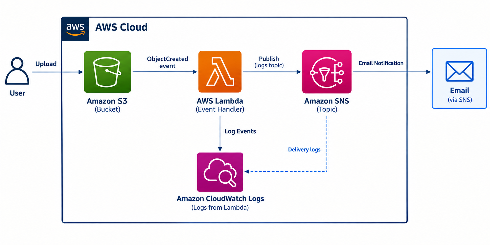
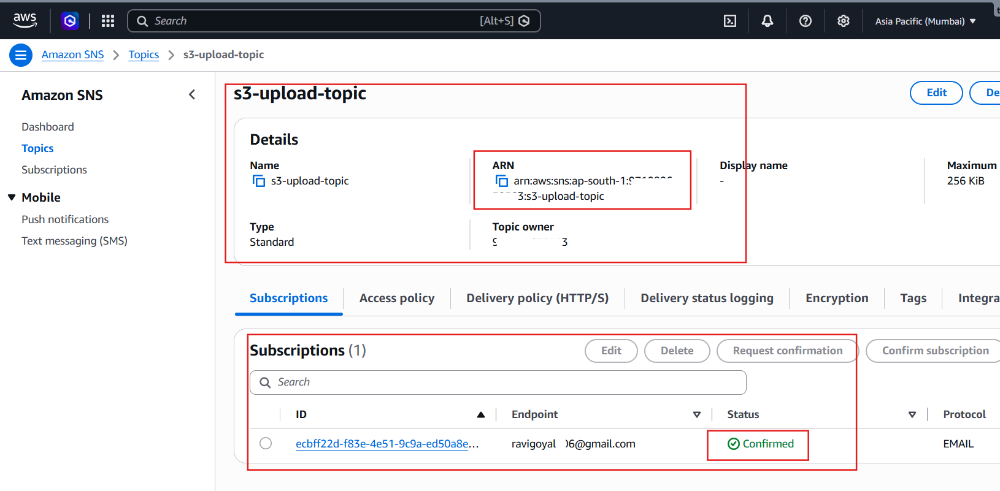
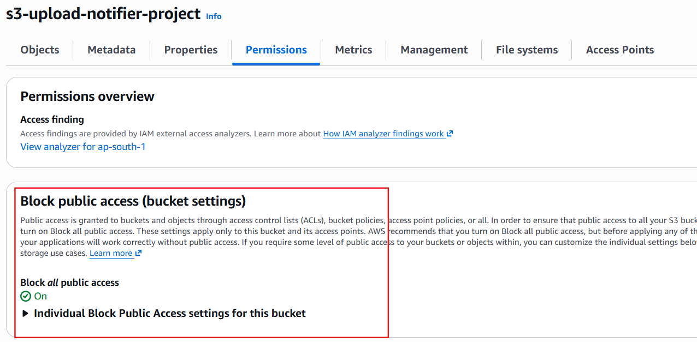
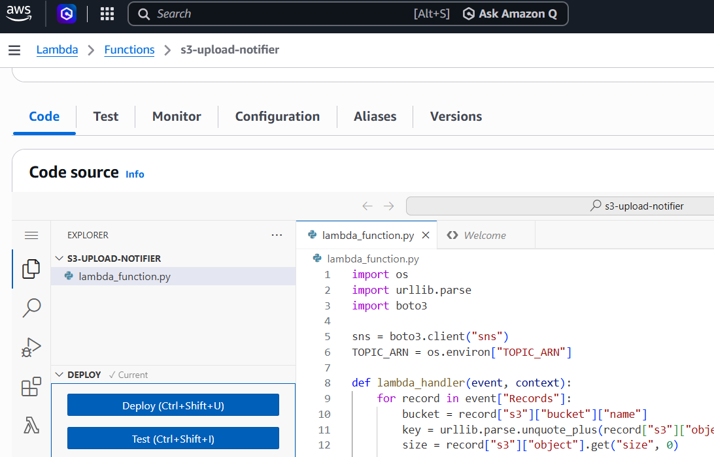
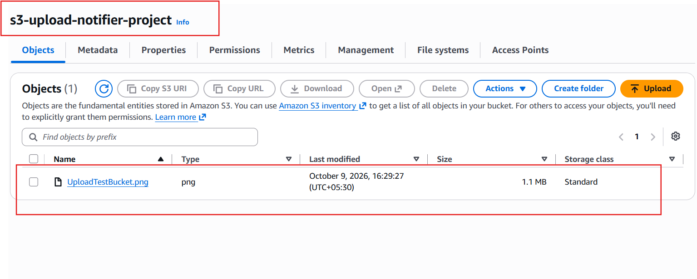
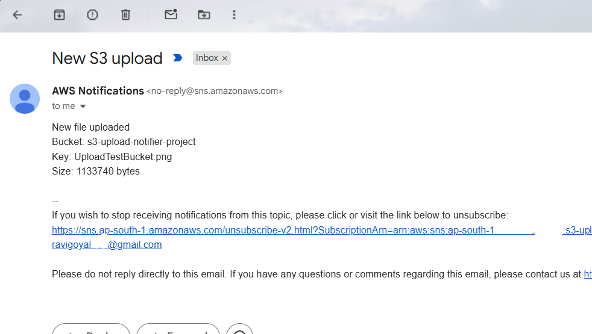
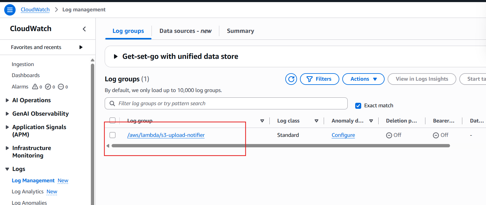
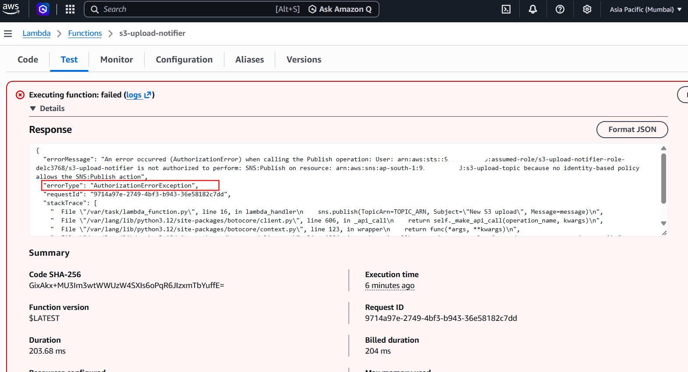

# S3 Upload Notifier

Upload a file to S3, and a Lambda function automatically sends an email through SNS. 

**Jump to:** [Architecture](#architecture) · [SNS](#step-1-create-the-sns-topic) · [S3](#step-2-create-the-s3-bucket) · [Lambda](#step-3-create-the-lambda-function) · [IAM](#step-4-configure-iam-permissions) · [Trigger](#step-5-add-the-s3-trigger) · [CloudWatch](#step-6-test-and-check-cloudwatch-logs) · [Errors](#errors-and-troubleshooting) · [Learned](#what-i-learned) · [Use Cases](#use-cases) · [Cost](#cost) · [Cleanup](#cleanup)

## Architecture
<details>
<summary>Screenshot: architecture diagram</summary>



</details>

**How it flows**
- A file is uploaded to the S3 bucket.
- S3 sends an event to Lambda (asynchronously, S3 does not wait for a reply).
- Lambda reads the file name and size, then publishes a message to SNS.
- SNS emails every confirmed subscriber.
- Lambda's output is written to CloudWatch Logs automatically.

**Two permissions make this work**
- **S3 to Lambda:** a resource-based policy on the function says S3 may invoke it.
- **Lambda to SNS:** the function's execution role says it may publish to the topic.
---

## Step 1: Create the SNS Topic

**Purpose:** SNS is a publish and subscribe service. Lambda publishes once, and SNS delivers to any number of subscribers. This keeps the function independent of how people are notified.

**Steps**
1. Go to **SNS, Topics, Create topic**.
2. Type **Standard**, name `s3-upload-topic`, then **Create topic**.
3. Copy the **Topic ARN**.
4. Choose **Create subscription**, protocol **Email**, and enter your address.
5. Open the confirmation email and click **Confirm subscription**.

**Key points**
- Until the subscription is confirmed, no email is delivered.
- Standard topics support email. FIFO topics do not.
- A valid ARN looks like `arn:aws:sns:us-east-1:123456789012:s3-upload-topic`.

<details>
<summary>Screenshots: topic and subscription</summary>



</details>

---

## Step 2: Create the S3 Bucket

**Purpose:** S3 is the event source. It detects a new object and notifies Lambda.

**Steps**
1. Go to **S3, Create bucket**.
2. Name it `s3-upload-notifier-project`.
3. Use the same region as the topic and the function.
4. Keep **Block all public access** turned on, then **Create bucket**.

**Key points**
- Bucket names are globally unique, so adding the account ID avoids clashes.
- The bucket does not need to be public, so it stays private.

<details>
<summary>Screenshot: bucket with Block Public Access on</summary>



</details>

---

## Step 3: Create the Lambda Function

**Purpose:** Lambda runs the code only when an event arrives. There are no servers to manage.

**Steps**
1. Go to **Lambda, Create function, Author from scratch**.
2. Name `s3-upload-notifier`, runtime **Python 3.12**, keep the default new execution role, then **Create function**.
3. Paste the code below and click **Deploy**.
4. Go to **Configuration, Environment variables** and add `TOPIC_ARN` with the topic ARN.
5. Under **General configuration**, set timeout to 10 seconds. The default 128 MB memory is enough.

**Key points**
- The handler `lambda_function.lambda_handler` means file name plus function name.
- The ARN is stored in an environment variable, not hardcoded.
- Always click **Deploy**. Saved but undeployed code does not run.

<details>
<summary>Lambda code: lambda_function.py</summary>

```python
import os
import urllib.parse
import boto3

sns = boto3.client("sns")  # created once, reused on warm invocations
TOPIC_ARN = os.environ["TOPIC_ARN"]

if not TOPIC_ARN.startswith("arn:aws:sns:"):  # fail fast on bad config
    raise ValueError(f"TOPIC_ARN is not a valid SNS ARN: {TOPIC_ARN!r}")


def lambda_handler(event, context):
    records = event.get("Records")
    if not records:  # not an S3 event, ignore it
        print(f"Ignoring non-S3 event: {event}")
        return {"statusCode": 200, "body": "ignored"}

    for record in records:  # one event can hold several records
        bucket = record["s3"]["bucket"]["name"]
        key = urllib.parse.unquote_plus(record["s3"]["object"]["key"])  # S3 encodes keys
        size = record["s3"]["object"].get("size", 0)

        message = f"New file uploaded\nBucket: {bucket}\nKey: {key}\nSize: {size} bytes"
        print(message)  # goes to CloudWatch Logs

        sns.publish(TopicArn=TOPIC_ARN, Subject="New S3 upload", Message=message)

    return {"statusCode": 200}
```

</details>

<details>
<summary>Screenshots: function, code, environment variable</summary>




</details>

---

## Step 4: Configure IAM Permissions

**Purpose:** IAM controls who can do what. Three pieces are involved in this project.

**The three pieces**
- **Trust policy:** says the Lambda service may assume the role. Created automatically.
- **Execution role policies:** say what the function may do. The default allows writing logs. We add `sns:Publish`.
- **Resource-based policy:** says S3 may invoke the function. Created automatically when the trigger is added.

**Steps (add publish permission)**
1. Open the function, then **Configuration, Permissions**, and click the role name.
2. Choose **Add permissions, Create inline policy, JSON**.
3. Paste the policy below, name it `sns-publish`, and save.

**Key points**
- Least privilege: one action on one resource, not `sns:*` on `*`.
- The function holds no access keys. Lambda assumes the role and receives temporary credentials.
- The execution role controls what the function can do. The resource-based policy controls who can invoke it.

<details>
<summary>Policy: sns-publish (execution role)</summary>

```json
{
  "Version": "2012-10-17",
  "Statement": [
    {
      "Effect": "Allow",
      "Action": "sns:Publish",
      "Resource": "arn:aws:sns:us-east-1:<ACCOUNT_ID>:s3-upload-topic"
    }
  ]
}
```

</details>

<details>
<summary>Policy: trust policy (who can assume the role)</summary>

```json
{
  "Version": "2012-10-17",
  "Statement": [
    {
      "Effect": "Allow",
      "Principal": { "Service": "lambda.amazonaws.com" },
      "Action": "sts:AssumeRole"
    }
  ]
}
```

</details>

<details>
<summary>Policy: resource-based policy (who can invoke the function)</summary>

```json
{
  "Version": "2012-10-17",
  "Statement": [
    {
      "Effect": "Allow",
      "Principal": { "Service": "s3.amazonaws.com" },
      "Action": "lambda:InvokeFunction",
      "Resource": "arn:aws:lambda:us-east-1:<ACCOUNT_ID>:function:s3-upload-notifier",
      "Condition": {
        "StringEquals": { "AWS:SourceAccount": "<ACCOUNT_ID>" },
        "ArnLike": { "AWS:SourceArn": "arn:aws:s3:::s3-upload-notifier-<ACCOUNT_ID>" }
      }
    }
  ]
}
```

The `Condition` limits invocation to your own bucket and account. This protects against the confused deputy problem, where another account's bucket could otherwise trigger your function. The exact wording generated in your account may differ slightly.

</details>
---

## Step 5: Add the S3 Trigger

**Steps**
1. In the function, choose **Add trigger, S3**.
2. Select the bucket and the event type **All object create events**.
3. Acknowledge the recursion notice and choose **Add**.

**Key points**
- The console also creates the resource-based policy and the bucket notification for you. The CLI and Terraform methods make you do both manually.
- Never write output back into the bucket that triggers the function, or it will loop.


## Step 6: Test and Check CloudWatch Logs

**Steps**
1. Upload a new file to the bucket. Files uploaded before the trigger existed do not fire.
2. Check your inbox for the email.
3. Open **Lambda, Monitor, View CloudWatch logs** and read the latest log stream.

**Key points**
- Everything the function prints appears in CloudWatch Logs with no extra setup.
- Logs are always the first place to look when something fails.
- You can also test directly from the **Test** tab using the `s3-put` template.

<details>
<summary>Screenshots: upload, email, logs</summary>







</details>

---

## Errors and Troubleshooting

### Error 1: `KeyError: 'Records'`
- **Cause:** the function received an event that was not from S3, such as the default Test tab event.
- **Fix:** check `event.get("Records")` before looping, as the code above does.
- **Lesson:** never assume the shape of the input event.

### Error 2: `InvalidParameter: Topic Name`
- **Cause:** the `TOPIC_ARN` environment variable was not a valid topic ARN.
- **Fix:** copy the ARN from the SNS topic page, with no quotes or spaces.
- **Lesson:** `InvalidParameter` usually means a malformed ARN, while `NotFound` means a valid ARN for a topic that does not exist.

<details>
<summary>Screenshots: errors and fixes</summary>



</details>

### Quick checklist
- Is the SNS subscription **Confirmed**?
- Does the S3 trigger exist, in the same region as the bucket?
- Was the code **Deployed**?
- Is the variable named exactly `TOPIC_ARN`?
- Does the role allow `sns:Publish` on the correct topic?
- What do the CloudWatch logs say?

---

## Key Concepts

- S3 invokes Lambda asynchronously, and Lambda retries failed async invocations twice.
- Event delivery is at-least-once, so functions should be idempotent.
- A trust policy, an execution role policy, and a resource-based policy each answer a different question.
- Least privilege means one action on one resource.
- Credentials come from the execution role, never from code.
- Configuration belongs in environment variables.
- Handlers must validate their input.
- Logs are the fastest route to the root cause.
- The console hides work, which is why the CLI and Terraform versions are worth building.

## Use Cases

- Alert a team when files arrive in a shared bucket.
- Notify finance or operations when a report or invoice is uploaded.
- Start further processing such as virus scanning, image resizing, or data validation.
- Audit and monitor uploads to a sensitive bucket.
- Replace SNS with SQS or EventBridge later to feed larger workflows.

## Cost

### On the Free Tier
- **Lambda:** 1 million requests and 400,000 GB-seconds per month are always free.
- **SNS:** the free tier includes 1,000 email deliveries per month.
- **S3:** accounts created under the current Free Tier plan use credits, and a few small test files cost almost nothing.
- **CloudWatch Logs:** a small monthly allowance covers the log volume here.
- **Result:** effectively $0. Always confirm current limits on the official AWS Free Tier page.

## Cleanup

Delete in this order: empty and delete the **S3 bucket**, delete the **Lambda function**, delete the **IAM role**, delete the **SNS subscription and topic**, and delete the **CloudWatch log group** `/aws/lambda/s3-upload-notifier`.
Deleting a function does not delete its role or log group, so these are the ones people forget.